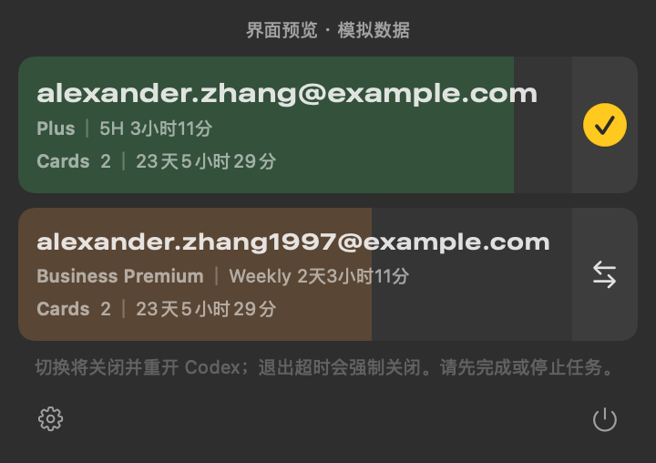

# Codex Accounts Switcher

[中文（默认）](README.md) · **English**

A compact native macOS menu bar app for manually switching Codex accounts, checking usage and reset credits, and continuing with local projects and chat history.



## Download

Current version: **0.1.15 (build 16)**. Requires **macOS 14 or later** and the Codex desktop app.

| Mac | Download |
| --- | --- |
| Apple Silicon (M1, M2, M3, M4 and other M-series chips) | [Download arm64](https://github.com/bobyunchaozhang/codex-accounts-switcher/releases/latest/download/Codex-Accounts-0.1.15-arm64.zip) |
| Intel | [Download x86_64](https://github.com/bobyunchaozhang/codex-accounts-switcher/releases/latest/download/Codex-Accounts-0.1.15-x86_64.zip) |

See [Releases](https://github.com/bobyunchaozhang/codex-accounts-switcher/releases) for notes and SHA-256 checksums. Check your chip under Apple menu → About This Mac.

Unzip, move `Codex Accounts.app` to Applications, open it, and click the account icon in the menu bar. Packages are ad-hoc signed and are not Apple Developer ID notarized. If macOS blocks the first launch, use System Settings → Privacy & Security to allow this app after checking its source. You do not need to disable system security checks.

## Usage

1. Sign into your first account in Codex, open the switcher, and choose “收录当前账号” (save current account).
2. Open the gear → “添加账号” (add account) and sign into another account through the official browser flow. Adding an account leaves the current Codex account active.
3. Finish or stop running Codex tasks, then click the arrow beside the target account. The tool closes and reopens Codex and checks the resulting identity. A gold check indicates the confirmed current local identity.
4. Continue using local projects and existing chats. Open the original chat manually when needed.

Settings also provides re-login and removal. Removal deletes only the tool's saved copy. There is no automatic quota-based switching, automatic reset-credit consumption, or automatic model test message. The app interface currently uses Chinese labels; these documentation pages are bilingual.

## Features

- One row per account, with background color and fill indicating remaining usage; the 5-hour window takes priority when available, otherwise the weekly window is shown.
- Remaining days/hours/minutes until usage reset or the nearest reset-credit expiry. Refreshes every five minutes while running, when opening the panel, and after switching; failures retain cached values.
- Subscription labels, reset-credit counts, manual switching, and isolated account login.
- Shared local projects, chats, configuration and Skill files. MCP authorization remains subject to each service.
- Exit verification, atomic credential replacement, and backups before necessary state writes.

## Tested Codex versions

**Latest Codex desktop version experimentally inspected for this release: 26.1106.51428 (build 26605, November 12, 2026).**

| Scope | Evidence |
| --- | --- |
| Codex 26.1106.51428 | Inspected bundled migration code and performed a read-only dry run against real local state; supports its public project/chat catalogs and new identity field |
| Switcher 0.1.15 | 84 core tests and 2 isolated application lifecycle tests with fixture credentials; a real online Codex account roundtrip and continuation on this release still await acceptance testing |
| Codex 26.1103.41825 | Earlier limited Apple Silicon tests covered project visibility, continuing existing chats across accounts, and project creation/renaming/deletion. Later versions exposed exit and storage compatibility issues; those tests are not a permanent compatibility guarantee |
| Apple Silicon | Build, execution and local checks on an M4 Pro development Mac |
| Intel | Native x86_64 download; release CI builds, tests and checks mock UI initialization, layout and resources on an Intel runner. Intel hosted VMs lack a usable Metal device, so GPU rendering is not accepted there. Real Codex switching has not been accepted on a physical Intel Mac |

Adapters recognize legacy account snapshots and the newer shared catalogs. Unknown or conflicting formats stop before credential writes. Codex internal formats and protocols can change. “Latest inspected” describes our evidence, not the latest official Codex release.

## Data and operating limits

- Supports the `~/.codex/auth.json` **file** credential mode and the desktop app with bundle ID `com.openai.codex`; its installation path may be `/Applications/ChatGPT.app`. Custom `CODEX_HOME`, Keychain/auto storage and forced-workspace policies are outside the verified scope.
- Saved account copies live in `~/Library/Application Support/CodexAccounts/`, with `0700` directory and `0600` file permissions. **Credentials are local files, not Keychain-encrypted storage.** Do not share or commit this directory.
- Newer Codex builds already share public project/chat catalogs; legacy builds use a validated current view to align the target. The tool does not copy chat databases or modify configuration, Skills, chat content or SQLite data.
- Without a reliable live task-status endpoint, task status is unknown: the tool tries a normal quit and may then force-quit identified target processes after a timeout. Finish or stop your work first.
- The checkmark confirms local identity. It does not guarantee an online model request or MCP authorization. Automatically restoring the selected chat is not implemented.

## Build from source

Install Xcode or a suitable Swift/macOS SDK, then run from the repository root:

```sh
# Apple Silicon
zsh 产品/scripts/package-release.sh arm64

# Intel (cross-compilation is supported; running needs matching hardware or Rosetta)
zsh 产品/scripts/package-release.sh x86_64

# Core tests
cd 产品
swift test --filter AccountCoreTests

# Full tests, including an isolated GUI app; requires a macOS graphical session
zsh scripts/test-desktop-lifecycle.sh
```

Apps are written to `产品/dist/<architecture>/Codex Accounts.app`. ZIPs and checksums are written to `release-assets/`. GitHub Actions builds on separate Apple Silicon and Intel runners and publishes both packages when a `v*` tag is pushed.

## Feedback and license

Open an [issue](https://github.com/bobyunchaozhang/codex-accounts-switcher/issues) with the switcher version, Codex version, Mac chip, steps and exact error. Redact emails, chat content and tokens first.

Source code is under the [MIT License](LICENSE). Font and icon licenses are listed in [Third-party notices](THIRD_PARTY_NOTICES.md). This is an independent project and is not affiliated with OpenAI.
