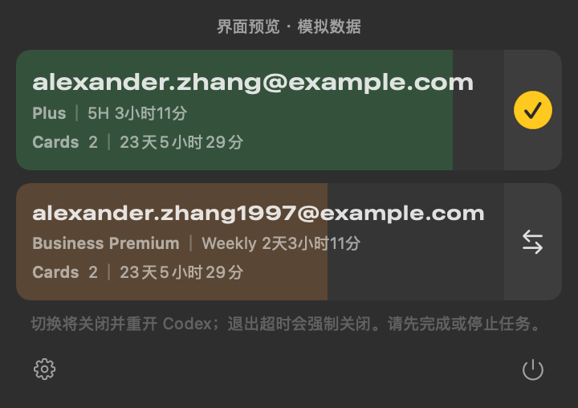

# Codex Accounts Switcher

**中文** · [English](README.en.md)

一个简洁的 macOS 原生菜单栏工具：手动切换 Codex 账号，查看额度与重置卡，沿用本机项目和聊天记录。



## 下载

当前版本：**0.1.15（构建 16）**，要求 **macOS 14 或更新版本**，并安装 Codex 桌面应用。

| Mac 类型 | 下载 |
| --- | --- |
| Apple Silicon（M1、M2、M3、M4 等 M 系列芯片） | [下载 arm64 版](https://github.com/bobyunchaozhang/codex-accounts-switcher/releases/latest/download/Codex-Accounts-0.1.15-arm64.zip) |
| Intel | [下载 x86_64 版](https://github.com/bobyunchaozhang/codex-accounts-switcher/releases/latest/download/Codex-Accounts-0.1.15-x86_64.zip) |

也可以在 [Releases](https://github.com/bobyunchaozhang/codex-accounts-switcher/releases) 查看版本说明与 SHA-256 校验文件。在苹果菜单 →「关于本机」查看芯片类型。

解压后，将 `Codex Accounts.app` 拖到「应用程序」并打开，从菜单栏的账号图标进入。发布包采用 ad-hoc 签名，尚未经过 Apple Developer ID 公证；首次打开若被拦截，请在系统设置 → 隐私与安全性中为你确认来源的应用允许打开，无需关闭系统安全检查。

## 使用

1. 在 Codex 登录第一个账号，打开工具，点击「收录当前账号」。
2. 齿轮 → 添加账号，在官方浏览器登录其他账号。添加不会改变当前 Codex 账号。
3. 完成或停止 Codex 中的任务，再点击目标账号右侧箭头。工具退出并重开 Codex，随后核对身份；金色对勾表示已确认的当前本地身份。
4. 项目和原聊天继续沿用本机数据。需要时手动打开原聊天。

设置中可重新登录或移除账号。移除只删除工具保存的副本。工具不会自动按额度换号，不消费重置卡，也不自动发送模型测试消息。

## 功能

- 每个账号一行，背景色和填充表示剩余额度；优先展示 5 小时窗口，否则展示周窗口。
- 额度重置、最近重置卡到期显示剩余天／小时／分钟；运行期间每 5 分钟、打开面板和切换后刷新，失败保留缓存。
- 显示订阅类型、重置卡数量；手动切换和隔离添加账号。
- 共用本地项目、聊天、配置与 Skill 文件；MCP 的账号授权仍由相应服务决定。
- 切换前确认客户端退出，原子替换认证，必要状态写入前备份；网络或启动异常保留明确结果。

## Codex 兼容与验证记录

**本版本最新已实验核查的 Codex 桌面版：26.1106.51428（构建 26605，2026-11-12）。**

| 范围 | 已完成的验证 |
| --- | --- |
| Codex 26.1106.51428 | 安装包迁移代码核查、真实本地状态只读预演；适配公共项目／聊天清单与新版身份字段 |
| 本工具 0.1.15 | 84 项核心测试、2 项独立测试应用的真实关闭／重开与虚构账号往返；最新真实 Codex 在线往返与续聊尚待验收 |
| Codex 26.1103.41825 | 早期 Apple Silicon 本机项目显示、跨账号原聊天续聊及项目新增／改名／删除的有限样本通过；后续版本发生过退出及结构兼容缺陷，不能视为长期保证 |
| Apple Silicon | M4 Pro 开发机完成构建、运行及上述本机检查 |
| Intel | 提供原生 x86_64 包，发布流水线在 Intel runner 构建、测试并渲染模拟界面；尚未在实体 Intel Mac 上验收真实 Codex 切换 |

工具按实际存储结构适配旧账号快照和新公共清单，未知／冲突格式在写入前停止。Codex 内部格式和协议升级后可能需要更新本工具。这里的“最新已核查版本”指我们的验证记录，不代表官方当前最新版。

## 数据与使用边界

- 目前适配 `~/.codex/auth.json` 的 **file** 模式及 `com.openai.codex` 桌面应用；安装路径可能显示为 `/Applications/ChatGPT.app`。自定义 `CODEX_HOME`、Keychain/auto 和强制工作区策略不在已验证范围。
- 账号副本保存在 `~/Library/Application Support/CodexAccounts/`，目录／文件权限为 `0700`／`0600`。**凭证是本地文件存储，未使用 Keychain 加密。**请勿分享该目录或把它加入版本控制。
- 新版 Codex 的公共项目和聊天清单直接共用；旧版按当前有效视图对齐目标。工具不复制聊天数据库，不修改配置、Skill、聊天正文或 SQLite 数据。
- 没有可靠的桌面任务检测接口时，按未知状态处理：先正常退出，超时后可能强制结束已识别的目标进程。请先完成／停止任务。
- 当前对勾表示本地身份核对通过；在线服务可用性、MCP 授权及自动回原聊天不由该标记保证。自动回原聊天尚未实现。

## 从源码构建

安装 Xcode 或适用的 Swift／macOS SDK，在仓库根目录执行：

```sh
# Apple Silicon
zsh 产品/scripts/package-release.sh arm64

# Intel（可交叉编译；运行需对应硬件或 Rosetta）
zsh 产品/scripts/package-release.sh x86_64

# 核心测试
cd 产品
swift test --filter AccountCoreTests

# 完整测试：包括独立 GUI 测试应用，需要可用的 macOS 图形会话
zsh scripts/test-desktop-lifecycle.sh
```

应用在 `产品/dist/<架构>/Codex Accounts.app`，ZIP 和校验文件在 `release-assets/`。GitHub Actions 分别在 Apple Silicon 与 Intel runner 构建，推送 `v*` 标签后自动发布两个下载包。

## 反馈与许可

请在 [Issues](https://github.com/bobyunchaozhang/codex-accounts-switcher/issues) 提供工具版本、Codex 版本、Mac 芯片、操作顺序和错误原文；请先遮盖邮箱、聊天内容与任何令牌。

源码采用 [MIT License](LICENSE)，字体与图标许可见 [第三方声明](THIRD_PARTY_NOTICES.md)。本项目为独立工具，与 OpenAI 无隶属关系。
